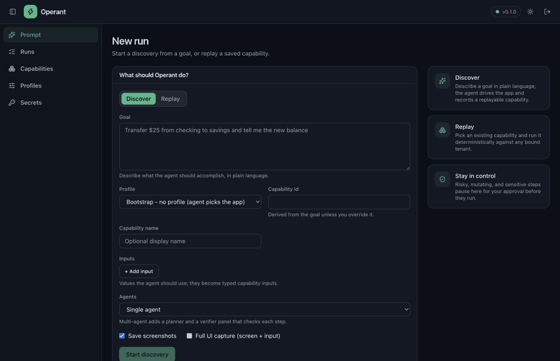
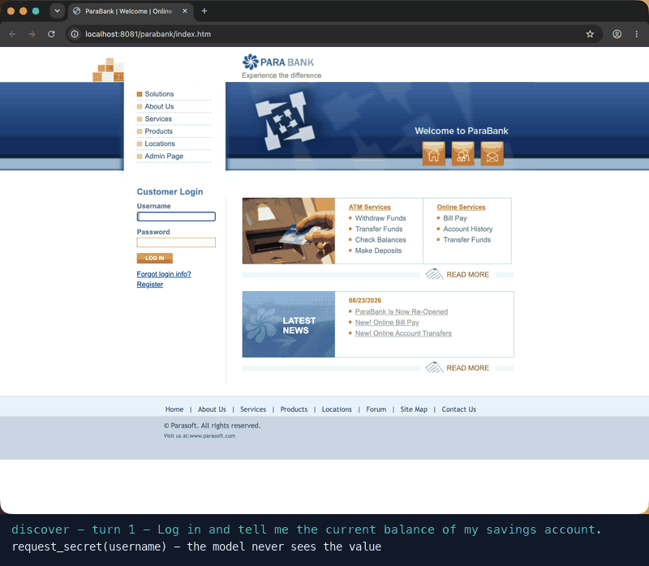
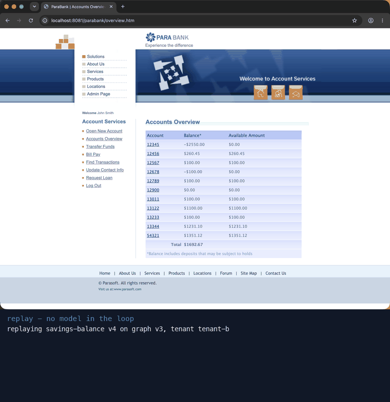

# Operant

Operant runs tasks inside apps that have no API. A model works out the
task once by looking at the screen and acting like a person. Operant saves
what worked as a typed, versioned capability and replays it with no model
in the loop. Every risky, mutating or sensitive step pauses for a human.



The goal is typed into the desktop app. The agent logs in to a local
ParaBank with stored credentials and reads the balance, then the saved
capability replays for another account with no model calls
([MP4](docs/media/demo.mp4)).

| Discover (model drives the app) | Replay (no model) |
|---|---|
|  |  |

## How it works

1. Discover: the model drives the real screen through the macOS
   accessibility tree (no DOM needed) until the goal is done.
2. Compile: the recording becomes a capability with typed inputs and
   outputs, the path of steps, how each control is found, and checkpoints.
3. Replay: the capability runs again with no model. It re-localizes the
   live screen first, so it resumes from wherever the app already is.

- The model never sees a credential value. It asks for a secret by name,
  and a human or the secret store supplies the value out of its sight.
- Screen text reaches the model as untrusted data, and a stored credential
  is typed only into a field that asks for that kind of credential.
- Replay runs no model, so on-screen text cannot steer it.

## Results

Claude Haiku 4.5 in every role, over three app skins (bank, CRM, HR).
Details and every table are in [docs/EVALS.md](docs/EVALS.md).

| Measure | Single agent | Multi agent |
|---|---|---|
| Eval pass rate | 97% (n=117) | 100% (n=126) |
| Cost per trial | $0.033 | $0.058 |
| Prompt-injection attacks that reached the page | 0 of 36 | 2 of 36, then 0 of 9 after the guard |

- Replay takes about 7 seconds, 2.5x to 4.3x faster than discovery.
- Across 11 kinds of UI change, replay never acted on the wrong control.
  When it could not tell, it stopped for a person.


## Quick start

You need Python 3.12 and [uv](https://docs.astral.sh/uv/). Live runs also
need macOS with Accessibility and Screen Recording permission, and a model
API key for discovery. Replay needs no key.

```bash
uv sync                  # install Python dependencies
cp .env.example .env     # then put your ANTHROPIC_API_KEY in .env
uv run operant migrate   # create the database
uv run pytest            # runs anywhere, with no model or target app
```

Run the demo against ParaBank, a public bank sandbox (login `john` /
`demo`):

```bash
docker compose up -d parabank-b   # ParaBank on http://localhost:8081

uv run operant discover \
  --goal "Log in and read the current balance of the first account" \
  --profile parabank --tenant tenant-b --capability savings-balance

uv run operant replay savings-balance --tenant tenant-b
```

`bash scripts/gen_evidence.sh` runs the discovery, the replay and an
error replay with an injected session expiry, and writes evidence for
each to `evidence/`.

To skip the terminal, run the desktop app with
`cd desktop && pnpm install && pnpm start`.

## Further reading

- [docs/GUIDE.md](docs/GUIDE.md): settings, web UI, desktop app,
  multi-agent mode, tracing, PII scrubbing, commands.
- [docs/EVALS.md](docs/EVALS.md): how to run the evals and every result.
- [ARCHITECTURE.md](ARCHITECTURE.md): how the system is built.
- [docs/DESIGN.md](docs/DESIGN.md): design approach, requirements and
  trade-offs.
- [REPORT.md](REPORT.md): the design write-up.
- [docs/adr/](docs/adr/): design decisions (ADRs 1–14).
- [docs/conventions.md](docs/conventions.md): the coding standard,
  enforced by `uv run i lint`.

## Layout

```
src/operant/  domain ports application adapters infra server cli
web/          the React and TypeScript UI
desktop/      the Electron app
policies/ graphs/ artifacts/ evidence/ state/
```
